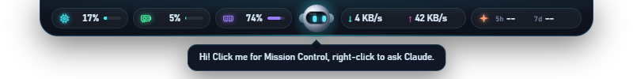

# Mission Control

**macOS support:** The macOS backend is implemented in `src/macos`. See [MACOS.md](MACOS.md) for setup, feature coverage and permission requirements.

**Rust edition:** [`rust/`](rust/README.md) holds a Tauri build with the backend rewritten in Rust. It runs the same
interface and features in a 5 MB app instead of Electron's ~300 MB. **Just want to install it?** Ready-made installers for
Windows and Apple Silicon Macs are in [`installers/`](installers/README.md); no developer tools needed.

A futuristic system widget for Windows and macOS that hangs from the top-center of your screen like a notch,
with an animated robot pet, live PC stats, device controls, internet speed tests, a cache cleaner,
and a built-in AI chat that can control your PC through
[Claude Code](https://claude.com/claude-code) or the OpenAI Codex CLI, whichever you have.



## Features

- **Always-on notch**: CPU, GPU and RAM on the left, live download/upload speed and your AI usage
  limits on the right (Claude Code 5-hour and weekly; Codex windows as your plan reports them). With
  both installed, the usage chip alternates between them. With neither installed, the right side and
  the chat disappear and the notch re-centres around the stats and the pet.
- **Animated pet**: its eyes follow your cursor and it blinks. It is happy when you hover over it,
  sweats and turns red when CPU or RAM is maxed out, spins an orbit ring while Claude works, gets
  excited during speed tests and falls asleep when you're away. It also shows speech bubbles for
  important events (high load, a nearly full disk, connection lost or back, Claude finished).
- **Mission Control panel** (click the pet):
  - **Overview**: CPU / RAM / GPU / VRAM gauges, GPU temperature and power, a load history graph,
    per-thread load, storage per drive, uptime and system info.
  - **Controls**: one place for your PC's inputs, outputs and toggles, synced live with Windows:
    - Wi-Fi and Bluetooth on/off, with Wi-Fi networks (connect to saved ones) and paired Bluetooth
      devices with their connection status
    - Sound and microphone mute, volume and mic level sliders, and switching the default output
      or input device
    - Monitor brightness over DDC/CI (laptop panels through WMI)
    - Dark mode, the "now playing" media session with play/pause/next/previous and a visualiser
    - Power plan switching, Lock, Sleep, Restart and Shut down (the last three ask you to confirm)
    - Shortcuts to the matching Windows Settings pages
  - **Network**: a live transfer graph, constant ping / jitter / packet-loss monitoring, a speed
    test you start by hand (download, upload, ping, jitter, loss) and test history.
  - **Apps**: running apps and background processes grouped by executable and sorted by memory,
    with "End task" (critical system processes are protected).
  - **Cleaner**: scans user and Windows temp files, Chrome / Edge / Brave / Firefox caches, GPU
    shader caches, crash dumps, thumbnail cache, npm / pip caches, Windows Update downloads and the
    Recycle Bin, then deletes what you select after you confirm.
  - **Settings**: launch at startup, idle during fullscreen, collapse on click-away, Claude
    permission mode, and auto-refresh of Claude limits.
- **AI chat** (right-click the pet): ask Claude Code or Codex to open apps, find files, change
  settings, explain what is using your RAM, and so on. Every command the AI runs shows as a chip.
  With both installed, switch between them in the chat header.
- **Energy friendly**: while any app is fullscreen (games, videos, presentations) the widget hides
  and stops all sampling. When folded up, the window shrinks to just the notch and the pet animates
  only in short bursts.
- **Fluid motion**: spring-based morphing between notch, panel and chat, smooth scrolling charts
  and tweened numbers.

| Mission Control | Network |
| --- | --- |
|  |  |

| Claude Code chat | Cleaner |
| --- | --- |
|  |  |

## Requirements

- **Windows 10 or 11** (x64), or **macOS** (Apple Silicon or Intel). Linux is not supported.
- On macOS: install Xcode Command Line Tools (`xcode-select --install`) for the Swift helper. See the [macOS quick start](#macos-quick-start) below.
- **Node.js 18+** and npm.
- **Optional:** an **NVIDIA GPU** with `nvidia-smi` (it ships with the driver) for GPU / VRAM /
  temperature stats. Other GPUs show "No NVIDIA data".
- **Optional:** the **Claude Code CLI** and/or the **OpenAI Codex CLI**, installed and signed in,
  for the chat and usage limits. Everything else works without either, and anything for a CLI that
  isn't installed (its usage chip, chat option and settings) stays hidden.
  - Claude Code is found from the native installer (`~/.local/bin`), `PATH`, WinGet or npm.
  - Codex is found on `PATH` (npm, WinGet, Scoop, standalone) or in npm's global folder. The copy
    bundled inside the OpenAI extension for VS Code / Cursor / Windsurf is **not** used unless you
    turn on **Settings → Use Codex from your code editor** (shown only when such a copy exists).

## Install and run

- [Windows](#windows)
- [macOS](#macos-quick-start)
- [Rust edition (Windows and macOS)](#rust-edition-windows-and-macos): the same widget as a 5 MB native app

### Windows

```powershell
git clone https://github.com/Shadhin-f/mission-control-widget.git
cd mission-control-widget
npm install
npm start
```

The notch appears at the top-center of your main display, and a tray icon appears next to the clock.

On first launch, Mission Control registers a **Task Scheduler "at log on" task** (no admin rights
needed) so it **starts as soon as you sign in**. Run-key entries and Startup-folder shortcuts wait
behind every other startup app, which can take minutes on a busy PC. If the task can't be created,
it falls back to a Startup-folder shortcut. You can turn this off in **Settings → Launch at
startup** or from the tray menu. If you move the folder, launch it once from the new place and the
task updates itself.

**Windows troubleshooting**

- **`npm start` says Electron failed to install / `electron.exe` is missing.** The Electron
  download sometimes gets skipped. Run:
  ```powershell
  node node_modules/electron/install.js
  ```
- **GPU shows "No NVIDIA data".** `nvidia-smi` was not found on `PATH`. This is expected on
  AMD / Intel GPUs.
- **Chat says "Claude Code CLI not found".** Install Claude Code and run `claude` once in a
  terminal to sign in.
- **Some cleaner items free less than expected.** Files that are in use (an open browser, Explorer
  thumbnails) are skipped. Close the app and clean again. Items tagged **ADMIN** need the widget to
  run as administrator to be cleaned fully.

### macOS quick start

**1. Install the prerequisites** (once):

```bash
xcode-select --install          # Xcode Command Line Tools: compiles the native Swift helper
brew install node               # Node.js 18+ (or use the installer from nodejs.org)
brew install blueutil           # optional: lets the widget switch Bluetooth on/off
```

**2. Get it and run it:**

```bash
git clone https://github.com/Shadhin-f/mission-control-widget.git
cd mission-control-widget
npm install                     # also builds src/macos/MissionControlHelper.app for your Mac
npm start
```

The notch appears at the top-center of your main display, just below the menu bar (and below the
camera notch on MacBooks that have one). Its icon sits in the **menu bar**; there is no Dock icon.

**3. Allow what you want to use.** macOS asks the first time a feature needs a permission. You can
also turn these on later in **System Settings → Privacy & Security**:

| Permission | What it unlocks |
| --- | --- |
| **Location** | Wi-Fi network names and the list of nearby networks (macOS hides them otherwise) |
| **Automation** | Dark mode toggle, and now-playing info and controls for Music and Spotify |
| **Accessibility** | Play/pause/next/previous for other media players (sent as media keys) |
| **Screen Recording** | Recognising which app is fullscreen, for idle mode |
| **Full Disk Access** | Cleaning the Safari cache and the Trash |
| **Bluetooth** | The list of paired Bluetooth devices |
| Your admin password | Switching Low Power mode on or off (asked each time, never stored) |

When you run from source with `npm start`, the prompt may name your terminal app (Terminal,
iTerm…) or **Electron** rather than Mission Control: allow whichever app it names. After changing
Screen Recording or Full Disk Access, quit the widget and start it again. Everything else works
without these; a feature whose permission is missing shows as unavailable instead of failing.

**4. Optional: build a standalone app** you can keep in Applications:

```bash
npm run package:mac             # creates dist/Mission Control.app (ad-hoc signed)
```

Drag `dist/Mission Control.app` into **Applications** and open it. To rebuild, delete
`dist/Mission Control.app` first. The app isn't notarized: if you copy it to another Mac and macOS
blocks it, Control-click it and choose **Open**, or click **Open Anyway** in
**System Settings → Privacy & Security**.

**Shortcuts on a Mac** use the **Control** key, not Command: **Control+Option+M** opens Mission
Control and **Control+Option+Space** opens the AI chat.

**Launch at startup on macOS:** running from source adds
`~/Library/LaunchAgents/com.missioncontrol.widget.plist`, so it starts at your next login. The
packaged app adds itself to **System Settings → General → Login Items** instead. Either way,
**Settings → Launch at startup** turns it off. If you move the folder, start it once from the new
place.

**Mac troubleshooting**

- **`npm install` fails with an `xcrun` or `swiftc` error.** The Xcode Command Line Tools are
  missing or out of date. Run `xcode-select --install`, then `npm run postinstall` to build the
  helper again.
- **Wi-Fi names are blank.** Allow **Location** for the app the prompt named (see step 3).
- **The Bluetooth switch does nothing.** Install `blueutil` with `brew install blueutil`.
- **No brightness slider for an external monitor.** macOS only exposes brightness for built-in
  and Apple displays; use the monitor's own buttons.
- **GPU temperature, power or fan show `--`.** macOS doesn't expose them without extra privileges.
  The widget shows `--` rather than guessing.

See [MACOS.md](MACOS.md) for how each feature works on macOS.

### Uninstall

1. Open **Settings → Launch at startup** and turn it off. This removes the startup task (Windows),
   or the LaunchAgent / Login Item (macOS).
2. Quit the widget from **Settings → Quit** or the tray / menu-bar icon.
3. Delete the project folder (and `Mission Control.app` from Applications if you built it).

If you already deleted the folder without step 1, remove the startup entry by hand:

- **Windows:** delete the **Mission Control** task in Task Scheduler.
- **macOS:** run `rm ~/Library/LaunchAgents/com.missioncontrol.widget.plist`, or remove it from
  **Login Items** if you used the packaged app.

### Rust edition (Windows and macOS)

The [`rust/`](rust/README.md) folder builds the same widget with [Tauri](https://tauri.app): the
interface is identical, but everything behind it is Rust, and it uses the system's own web view
instead of bundling Chromium. The result is a **~5 MB app** instead of ~300 MB. It reads and writes
the same settings file as the Electron edition, so you can switch between them freely. Run only
one edition at a time, because both sit in the same spot at the top of the screen.

> **Status:** fully tested on Windows 11. The macOS build compiles and is built by CI, but has not
> been run on a Mac yet. Reports are welcome.

**No build needed:** to just install the Rust edition, use the installers in
[`installers/`](installers/README.md): `Mission Control_1.0.0_x64-setup.exe` for Windows and
`Mission Control_1.0.0_aarch64.dmg` for Apple Silicon Macs. The steps below are for building it
yourself.

#### Windows

**1. Install the prerequisites** (once). In PowerShell:

```powershell
winget install Rustlang.Rustup
winget install Microsoft.VisualStudio.2022.BuildTools --override "--add Microsoft.VisualStudio.Workload.VCTools --includeRecommended --passive --wait"
winget install OpenJS.NodeJS.LTS
```

- **Rust** (via rustup) compiles the app. Accept the default `x86_64-pc-windows-msvc` toolchain.
- **Visual Studio Build Tools** with **Desktop development with C++** provide the linker and the
  Windows SDK. If you already have Visual Studio with that workload, skip this line.
- **Node.js 18+** is only used to run the Tauri command-line tool.
- **WebView2** is built into Windows 11. On Windows 10, install the
  [Evergreen runtime](https://developer.microsoft.com/microsoft-edge/webview2/) if it's missing.

Open a **new** terminal afterwards so `cargo` is on your `PATH`.

*Low on space on C:?* Rust's toolchain and download cache take about 1.5 GB. To keep them on
another drive, set these **before** installing rustup (the folders can be anywhere):

```powershell
[Environment]::SetEnvironmentVariable('RUSTUP_HOME', 'D:\Dev\rustup', 'User')
[Environment]::SetEnvironmentVariable('CARGO_HOME', 'D:\Dev\cargo', 'User')
```

The build output (several GB) always goes inside the project folder, in `rust\src-tauri\target`.

**2. Get it and run it:**

```powershell
git clone https://github.com/Shadhin-f/mission-control-widget.git
cd mission-control-widget\rust
npm install
npm run dev
```

The first build compiles a few hundred crates and takes several minutes; later runs take seconds.
`npm run dev` rebuilds and restarts the widget when you change the Rust code.

**3. Build the app you keep:**

```powershell
npm run build
```

This creates:

- `src-tauri\target\release\mission-control.exe`: the app itself, which you can run directly
- `src-tauri\target\release\bundle\nsis\Mission Control_1.0.0_x64-setup.exe`: an installer that
  adds it to the Start menu (no admin rights needed)

**Launch at startup** uses the same **Mission Control** Task Scheduler task as the Electron
edition, so whichever edition last had the setting on starts at sign-in.

**Windows troubleshooting**

- **``linker `link.exe` not found``.** The Visual Studio Build Tools or their C++ workload are
  missing. Install them (step 1), then open a new terminal.
- **`cargo` is not recognized.** Open a new terminal after installing rustup, or sign out and in.
- **The widget doesn't appear.** Check that the WebView2 runtime is installed, and that the
  Electron edition isn't already running in the same spot.

#### macOS

**1. Install the prerequisites** (once):

```bash
xcode-select --install                                           # compilers + Swift for the helper
curl --proto '=https' --tlsv1.2 -sSf https://sh.rustup.rs | sh   # Rust (choose the default install)
brew install node                                                # Node.js 18+ (or the nodejs.org installer)
brew install blueutil                                            # optional: Bluetooth on/off switch
```

Open a new terminal afterwards (or run `source "$HOME/.cargo/env"`) so `cargo` is on your `PATH`.

**2. Get it and run it:**

```bash
git clone https://github.com/Shadhin-f/mission-control-widget.git
cd mission-control-widget/rust
npm install
npm run dev
```

The build also compiles the native Swift helper (`src/macos/Helper.swift`) into
`rust/src-tauri/helper/`. The notch appears below the menu bar, and the icon sits in the menu
bar with no Dock icon, like the Electron edition.

**3. Build the app you keep:**

```bash
npm run build
```

This creates `src-tauri/target/release/bundle/macos/Mission Control.app` and a `.dmg` next to it
in `bundle/dmg/`. Drag the app into **Applications**. It's ad-hoc signed and not notarized: the
first time, Control-click it and choose **Open**, or click **Open Anyway** in
**System Settings → Privacy & Security**.

**4. Allow what you want to use.** The permissions are the same as for the Electron edition (see
the table in [macOS quick start](#macos-quick-start)). With the built app the prompts name
**Mission Control**; with `npm run dev` they may name your terminal app instead.

Shortcuts use **Control+Option+M** and **Control+Option+Space**. **Launch at startup** adds
`~/Library/LaunchAgents/com.missioncontrol.widget.plist` pointing at the app you're running.

**Mac troubleshooting**

- **`xcrun swiftc is required` or a `swiftc failed` error.** Run `xcode-select --install`, then
  build again.
- **Apple Silicon or Intel:** `npm run build` builds for the Mac you're on. Build on each kind of
  Mac you want to run it on.

See [rust/README.md](rust/README.md) for how the Rust code maps onto the Electron edition, and for
its test switches.

### Extreme mode (Windows only)

Turn on **Settings → Extreme mode** (or **Extreme mode** in the tray menu) to restyle the real
Windows taskbar to match the widget:

- a navy taskbar and Start menu, with the running-app indicators in the widget's cyan
- a thin cyan-to-violet glow line along the taskbar's top edge that grows in when you switch the
  mode on and sends a light sweep across when the pointer reaches the taskbar

It changes Windows' own accent-colour settings (the same ones as **Settings → Personalization →
Colors**), so it doesn't replace or inject code into the taskbar: tray icons, jump lists, previews,
notifications and Win+number shortcuts all keep working. It also turns on "Show accent colour on
Start and taskbar" and the dark system theme, which that option needs.

- **Your colours come back** when you turn it off, and whenever the widget quits (it's applied again
  on the next launch). The originals are saved first, including settings that didn't exist; if the
  widget ever crashes while the mode is on, the saved originals are kept and used on the next restore.
- **Cost:** no extra process (the glow line is a 5 px window opened from the widget's own page), and
  nothing animates while idle.
- The glow line shows only for a bottom taskbar that isn't set to auto-hide, and hides with the
  widget while a fullscreen app is running.
- Windows blends the taskbar colour with your wallpaper, so the exact navy varies slightly.

### Pet-only idle layout

In **Settings**, enable **Show sides only on hover** to keep only the pet visible while collapsed. Hover over the pet to reveal the stats and quick actions on either side. Move away to hide them again, or click the pet to open Mission Control. The preference is saved across launches and works on Windows and macOS. It is off by default, preserving the existing layout. Fullscreen visibility continues to follow **Idle during fullscreen**.

## Using it

| Action | How |
| --- | --- |
| Open Mission Control | Click the pet, press `Ctrl+Alt+M` (Mac: `Control+Option+M`), or click the tray / menu-bar icon |
| Ask Claude | Right-click the pet, press `Ctrl+Alt+Space` (Mac: `Control+Option+Space`), or hover the notch and click **Ask Claude** |
| Collapse | `Esc`, the ˄ button, or click anywhere else (use the pin button to keep it open) |
| Refresh Claude limits | Click the Claude usage chip on the right of the notch |
| Change volume from anywhere | Scroll over the pet |
| Quit | **Settings → Quit**, or the tray menu |


### Claude Code chat

The chat runs your locally installed Claude Code CLI (`claude -p` with streaming JSON output) using
**your existing Claude Code login**. Nothing is sent anywhere except through the CLI itself. One
conversation continues until you press **New conversation**.

Choose the permission mode in the chat header or in Settings:

| Mode | What Claude can do |
| --- | --- |
| **Auto** (default) | Runs safe actions itself; risky actions are blocked and listed in the chat |
| **Accept edits** | Can also edit files without asking |
| **Plan** | Read-only: looks and explains, changes nothing |

Claude is told to describe any destructive action and wait for your confirmation in the chat first.

### Codex chat and limits

- Chat runs `codex exec --json` in your home folder and continues the conversation with
  `codex exec resume`. Auto and Accept edits use Codex's `workspace-write` sandbox; Plan uses
  `read-only`.
- If the model in `~/.codex/config.toml` isn't available on your account, the widget picks the
  first model Codex lists for you. Your config file is never changed.
- Limits come from `codex app-server` (`account/rateLimits/read`), which costs no usage, so they
  refresh every 5 minutes and after every Codex reply. Paid plans (Plus, Pro, Business) show the
  **5-hour** and **weekly** windows, like Claude; the free plan only has a single 30-day window.
- Older Codex versions without that method fall back to the newest usage event Codex writes to
  `~/.codex/sessions` (only its `rate_limits` field is read).

### Claude usage limits (5h / 7d)

The right-hand chip shows how much of your Claude plan's **5-hour** and **weekly** limits you have
used. Hover over it to see when each one resets. The numbers come from the rate-limit information the
Claude Code CLI reports with every reply:

- Every message in the widget chat updates them at no extra cost.
- While a 5-hour window is already open, the widget refreshes every 10 minutes with a minimal
  Claude Code request (Haiku, no tools, a two-word prompt). It never starts a new window on its own.
  You can turn this off in Settings.
- Click the chip to refresh right away.

## Privacy

Mission Control has no telemetry, accounts or analytics. It only makes these network requests:

| What | Where | When |
| --- | --- | --- |
| Latency / packet-loss monitor | ICMP echo to `1.1.1.1` (TCP 443 fallback) | Every 3 s while visible |
| Speed test | `speed.cloudflare.com` | Only when you press **Run speed test** |
| Claude chat and usage limits | Through your local Claude Code CLI | When you chat, refresh, or auto-refresh is on |
| Codex chat and usage limits | Through your local Codex CLI | When you chat, and every 5 min for limits |

Settings (including speed-test history and the last known Claude limits) are stored only on your
PC in `%APPDATA%\Mission Control\settings.json`.

## How it works

```
main.js              Electron main: transparent always-on-top window, tray, shortcuts,
                     fullscreen idle loop, login item, IPC
preload.js           The small, safe API exposed to the UI (contextIsolation on)
src/native.js        Win32 via koffi: fullscreen detection, app windows, network
                     counters (GetIfTable2), native ICMP ping, Recycle Bin
src/stats.js         CPU per thread, RAM, disks, network rates, nvidia-smi stream
src/network.js       Live latency monitor + Cloudflare speed test
src/processes.js     tasklist + window enumeration, end task
src/cleaner.js       Cache / junk scanner and cleaner
src/claude.js        Claude Code CLI bridge (chat streaming + usage limits)
src/codex.js         Codex CLI bridge (detection, chat + resume, app-server usage limits)
src/extreme-windows.js  Extreme mode: themes the native taskbar via Windows accent settings,
                     with exact backup / restore, and finds the taskbar for the glow line
src/syscontrol.js    Controls tab backend: drives sysctl.ps1, netsh (Wi-Fi), powercfg
src/sysctl.ps1       Long-lived helper (started on first use, stops when idle): Core Audio,
                     Wi-Fi/Bluetooth radios, paired devices, media session, DDC/CI
                     brightness, dark mode, lock / sleep
src/settings.js      JSON settings in the user data folder
renderer/            UI: index.html, styles.css, app.js (pet, charts, tabs, chat)
rust/                The Rust (Tauri) edition: the same renderer with a Rust backend
                     (see rust/README.md)
```

- **Click-through:** the window is transparent and ignores the mouse everywhere except on the
  widget itself, so the desktop behind stays usable.
- **Idle mode:** every 1.5 s it checks whether the foreground window covers its whole monitor (or
  Windows reports a D3D fullscreen / presentation state). If so, the widget hides and stops sampling.

### Development

```powershell
npm start
```

Use **Reload widget** in the tray menu to pick up UI changes. There are two dev-only environment
variables:

- `MC_SHOTS=<folder>` renders every view to PNG files in that folder (used for the screenshots
  above). `MC_TABS=overview,network` limits which tabs are captured.
- `MC_DIAG=1` logs running CSS animations, which helps keep idle GPU use low.
- `MC_NO_AI=1` pretends neither Claude Code nor Codex is installed, to preview that layout.
- `MC_DEMO_CODEX=1` (with `MC_SHOTS`) previews the usage chip with sample paid-plan Codex numbers.

Dev runs with these variables never touch the startup task, so a test copy can't take over
launch-at-sign-in from your real install.

## Contributing

Issues and pull requests are welcome. Good first ideas:

- AMD / Intel GPU stats (for example through Windows performance counters)
- Multi-monitor placement options
- More pet moods and skins
- Packaging into a signed installer (electron-builder)

Please keep the widget light: avoid always-running animations and timers while it is collapsed.

## License

[MIT](LICENSE)

Not affiliated with Anthropic. "Claude" and "Claude Code" are trademarks of Anthropic.
