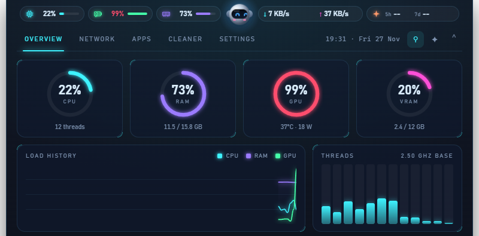
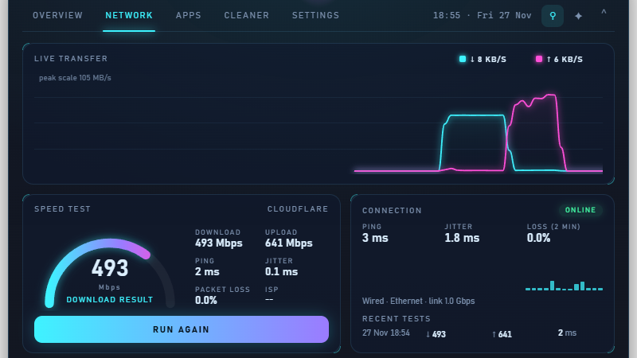
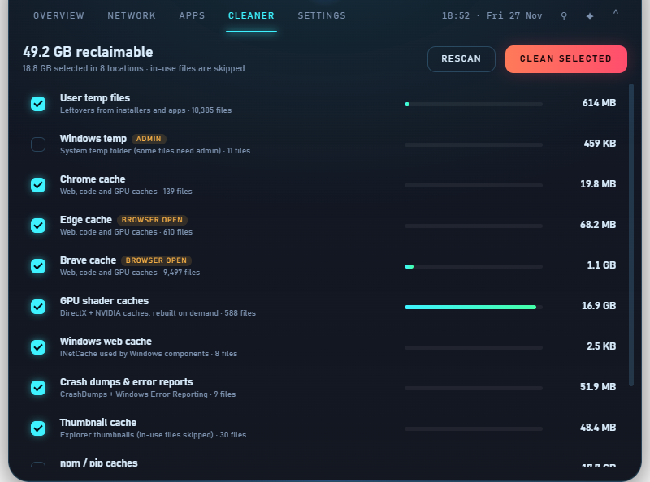

# Mission Control

A futuristic system widget for Windows that hangs from the top-center of your screen like a notch,
with an animated robot pet, live PC stats, internet speed tests, a cache cleaner, and a built-in
[Claude Code](https://claude.com/claude-code) chat that can control your PC.


## Features

- **Always-on notch**: CPU, GPU and RAM on the left, live download/upload speed and your Claude Code
  usage limits (5-hour and weekly) on the right, with an animated pet in the middle.
- **Animated pet**: its eyes follow your cursor and it blinks. It is happy when you hover over it,
  sweats and turns red when CPU or RAM is maxed out, spins an orbit ring while Claude works, gets
  excited during speed tests and falls asleep when you're away. It also shows speech bubbles for
  important events (high load, a nearly full disk, connection lost or back, Claude finished).
- **Mission Control panel** (click the pet):
  - **Overview**: CPU / RAM / GPU / VRAM gauges, GPU temperature and power, a load history graph,
    per-thread load, storage per drive, uptime and system info.
  - **Network**: a live transfer graph, constant ping / jitter / packet-loss monitoring, a speed
    test you start by hand (download, upload, ping, jitter, loss) and test history.
  - **Apps**: running apps and background processes grouped by executable and sorted by memory,
    with "End task" (critical system processes are protected).
  - **Cleaner**: scans user and Windows temp files, Chrome / Edge / Brave / Firefox caches, GPU
    shader caches, crash dumps, thumbnail cache, npm / pip caches, Windows Update downloads and the
    Recycle Bin, then deletes what you select after you confirm.
  - **Settings**: launch at startup, idle during fullscreen, collapse on click-away, Claude
    permission mode, and auto-refresh of Claude limits.
- **Claude Code chat** (right-click the pet): ask Claude to open apps, find files, change settings,
  explain what is using your RAM, and so on. Replies stream live, and every command Claude runs
  shows as a chip.
- **Energy friendly**: while any app is fullscreen (games, videos, presentations) the widget hides
  and stops all sampling. When folded up, the window shrinks to just the notch and the pet animates
  only in short bursts.
- **Fluid motion**: spring-based morphing between notch, panel and chat, smooth scrolling charts
  and tweened numbers.

| Mission Control | Network |
| --- | --- |
|  |  |

| Claude Code chat | Cleaner |
| --- | --- |
|  |  |

## Requirements

- **Windows 10 or 11** (x64). The widget uses Win32 APIs, so it does not run on macOS or Linux.
- **Node.js 18+** and npm.
- **Optional:** an **NVIDIA GPU** with `nvidia-smi` (it ships with the driver) for GPU / VRAM /
  temperature stats. Other GPUs show "No NVIDIA data".
- **Optional:** the **Claude Code CLI**, installed and signed in, for the chat and usage limits
  (see [Claude Code](https://claude.com/claude-code)). Everything else works without it.

## Install and run

```powershell
git clone https://github.com/Shadhin-f/mission-control-widget.git
cd mission-control-widget
npm install
npm start
```

The notch appears at the top-center of your main display, and a tray icon appears next to the clock.

On first launch, Mission Control registers itself to **start when you sign in to Windows**. You can
turn this off in **Settings → Launch at startup** or from the tray menu. If you move the folder,
launch it once from the new place and the startup entry updates itself.

### Troubleshooting

- **`npm start` says Electron failed to install / `electron.exe` is missing.** The Electron
  download sometimes gets skipped. Run:
  ```powershell
  node node_modules/electron/install.js
  ```
- **GPU shows "No NVIDIA data".** `nvidia-smi` was not found on `PATH`. This is expected on
  AMD / Intel GPUs.
- **Chat says "Claude Code CLI not found".** Install Claude Code and run `claude` once in a
  terminal to sign in.
- **Some cleaner items free less than expected.** Files that are in use (an open browser, Explorer
  thumbnails) are skipped. Close the app and clean again. Items tagged **ADMIN** need the widget to
  run as administrator to be cleaned fully.

## Using it

| Action | How |
| --- | --- |
| Open Mission Control | Click the pet, press `Ctrl+Alt+M`, or click the tray icon |
| Ask Claude | Right-click the pet, press `Ctrl+Alt+Space`, or hover the notch and click **Ask Claude** |
| Collapse | `Esc`, the ˄ button, or click anywhere else (use the pin button to keep it open) |
| Refresh Claude limits | Click the Claude usage chip on the right of the notch |
| Quit | **Settings → Quit**, or the tray menu |


### Claude Code chat

The chat runs your locally installed Claude Code CLI (`claude -p` with streaming JSON output) using
**your existing Claude Code login**. Nothing is sent anywhere except through the CLI itself. One
conversation continues until you press **New conversation**.

Choose the permission mode in the chat header or in Settings:

| Mode | What Claude can do |
| --- | --- |
| **Auto** (default) | Runs safe actions itself; risky actions are blocked and listed in the chat |
| **Accept edits** | Can also edit files without asking |
| **Plan** | Read-only: looks and explains, changes nothing |

Claude is told to describe any destructive action and wait for your confirmation in the chat first.

### Claude usage limits (5h / 7d)

The right-hand chip shows how much of your Claude plan's **5-hour** and **weekly** limits you have
used. Hover over it to see when each one resets. The numbers come from the rate-limit information the
Claude Code CLI reports with every reply:

- Every message in the widget chat updates them at no extra cost.
- While a 5-hour window is already open, the widget refreshes every 10 minutes with a minimal
  Claude Code request (Haiku, no tools, a two-word prompt). It never starts a new window on its own.
  You can turn this off in Settings.
- Click the chip to refresh right away.

## Privacy

Mission Control has no telemetry, accounts or analytics. It only makes these network requests:

| What | Where | When |
| --- | --- | --- |
| Latency / packet-loss monitor | ICMP echo to `1.1.1.1` (TCP 443 fallback) | Every 3 s while visible |
| Speed test | `speed.cloudflare.com` | Only when you press **Run speed test** |
| Claude chat and usage limits | Through your local Claude Code CLI | When you chat, refresh, or auto-refresh is on |

Settings (including speed-test history and the last known Claude limits) are stored only on your
PC in `%APPDATA%\Mission Control\settings.json`.

## How it works

```
main.js              Electron main: transparent always-on-top window, tray, shortcuts,
                     fullscreen idle loop, login item, IPC
preload.js           The small, safe API exposed to the UI (contextIsolation on)
src/native.js        Win32 via koffi: fullscreen detection, app windows, network
                     counters (GetIfTable2), native ICMP ping, Recycle Bin
src/stats.js         CPU per thread, RAM, disks, network rates, nvidia-smi stream
src/network.js       Live latency monitor + Cloudflare speed test
src/processes.js     tasklist + window enumeration, end task
src/cleaner.js       Cache / junk scanner and cleaner
src/claude.js        Claude Code CLI bridge (chat streaming + usage limits)
src/settings.js      JSON settings in the user data folder
renderer/            UI: index.html, styles.css, app.js (pet, charts, tabs, chat)
```

- **Click-through:** the window is transparent and ignores the mouse everywhere except on the
  widget itself, so the desktop behind stays usable.
- **Idle mode:** every 1.5 s it checks whether the foreground window covers its whole monitor (or
  Windows reports a D3D fullscreen / presentation state). If so, the widget hides and stops sampling.

### Development

```powershell
npm start
```

Use **Reload widget** in the tray menu to pick up UI changes. There are two dev-only environment
variables:

- `MC_SHOTS=<folder>` renders every view to PNG files in that folder (used for the screenshots
  above). `MC_TABS=overview,network` limits which tabs are captured.
- `MC_DIAG=1` logs running CSS animations, which helps keep idle GPU use low.

## Contributing

Issues and pull requests are welcome. Good first ideas:

- AMD / Intel GPU stats (for example through Windows performance counters)
- Multi-monitor placement options
- More pet moods and skins
- Packaging into a signed installer (electron-builder)

Please keep the widget light: avoid always-running animations and timers while it is collapsed.

## License

[MIT](LICENSE)

Not affiliated with Anthropic. "Claude" and "Claude Code" are trademarks of Anthropic.
